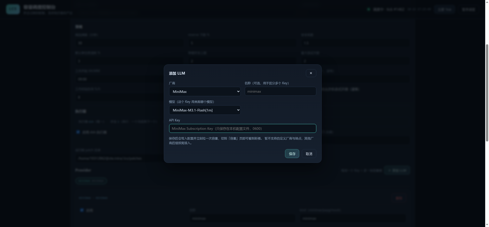

# llm-capacity-scheduler

> **面向 LLM 后端的「容量感知异步任务调度器」——把会过期的配额，变成有价值的产出。**

引擎持续监控**多个第三方 LLM 的容量窗口**（配额 / 限流 / 余额），结合**用户策略**决定
「**什么时候、用谁、用多强**」去执行队列里的任务；调用方（通常是 agent）只负责
`submit` 和 `poll`，不关心调度细节。


**单语言栈**：整个产品（MCP Server / 调度器 / 执行器 / Web 控制台）都是 TypeScript + Node，
位于 `mcp/`。v0.1 的 Python 参考实现已归档到 tag `v0.1-python` 并从主干移除。

**v0.3 执行模型**：执行器只有 **dsh headless**，任务**串行**执行（一个完成再下一个）；
每个 task 绑定一个 dsh session + 固定工作目录；「换模型」只是换 dsh 后端的大模型。
设计见 [`docs/DSH-EXECUTION-DESIGN.md`](docs/DSH-EXECUTION-DESIGN.md)。

## 快速开始

```bash
npm install -g llm-capacity-scheduler-mcp   # Node.js >= 20
lcs-mcp init                                # 生成 ~/.lcs/config.json
lcs-mcp serve                               # 调度器 + Web：http://127.0.0.1:7788
```

接入 provider 不用手改配置：打开 Web → **配置 → Provider → 「＋ 添加 LLM」**，
选厂商（当前支持 MiniMax）、填 API Key、保存 —— 引擎会立刻向 provider 拉一次容量，
切到「容量」页就能看到新桶；不用的 Key 点选项卡里的「删除」即可移除。也支持手写
`apiKey` / `apiKeyEnv` / `apiKeyFile` 三种方式。



agent 侧在 MCP 客户端里加一条 stdio server：

```jsonc
{
  "mcpServers": {
    "lcs": { "command": "lcs-mcp", "args": ["--config", "/home/you/.lcs/config.json"] }
  }
}
```

> 已有常驻 `lcs-mcp serve` 时，MCP 进程会自动检测并以 **HTTP 代理模式**接入同一个实例，
> 不会出现两个进程抢写状态文件。

agent 使用方式：

```text
lcs_submit_task  { cmd: ["python3","jobs/summarize.py"], value: 70, tokens: 120000,
                   expect_artifacts: ["summary.md"] }
→ state: "deferred"      # 提交 ≠ 执行：引擎会在合适的配额窗口自动开烧

lcs_poll_tasks   { ids: ["task_..."] }
→ state: "succeeded", runs[0].artifacts = ["summary.md"], verified: true
```

MCP 工具：`lcs_submit_task` / `lcs_poll_tasks` / `lcs_cancel_task` / `lcs_status` /
`lcs_observe` / `lcs_tick` / `lcs_get_config`。详细用法见 [`mcp/README.md`](mcp/README.md)。

## 要解决的问题

订阅制 LLM 的容量有几种**截然不同**的性质：

| 性质 | 后果 |
|---|---|
| 配额分**固定窗口**（如 MiniMax 5h：10-15 / 15-20） | 窗口内用不完就**作废**，官方明确不滚存 |
| 部分维度**周/月无限** | 真正稀缺的只有窗口内那一份 |
| 部分**只在工作时间需要** | 白天要留给自己写代码，深夜空闲才可自由消耗 |
| 另一些是**付费余额**（Credits / PAYG） | 烧它就是花钱，策略必须反转 |
| 还叠加 **rate limit / 并发槽位 / 高峰限流** | 这些**不作废**，不该当"配额"去优化时机 |

## 模型（v0.2 定稿）

```
Task ──(Queue 派生视图)──▶ Controller ──(Assignment)──▶ Runner ──▶ Run
  ▲                          │                                      │
  │                          ├─ ModelCatalog（能力匹配）              │
  │                          ├─ CapacityBuckets（容量 + reserve）     │
  │                          └─ Policy（准入 / 强度 / 优先级）        │
  └────────── checkpoint / step ◀──────── Artifact + Verifier ◀───────┘
```

六个实体：**Task**（要干的活）、**Run**（一次执行尝试）、**Assignment**（provider × model ×
runner × est × route）、**Queue**（任务状态的派生视图，不是独立队列）、**Capacity**
（provider 容量桶）、**Runner**（shell / dsh headless / 未来 HTTP）。

核心策略：**reserve(t) = 从 t 到窗口结束，预期自己还要用掉的容量**。

| 场景 | reserve | 行为 |
|---|---|---|
| 工作时段中段 | 高（≈ 预期自用） | 不烧 |
| 工作时段末尾 30min | → 下限（默认 5%） | 开烧，烧到下限停 |
| 深夜 / 周末 | ≈ 下限 | 一刷新就烧 |
| 窗口横跨上班时刻 | 含上班后自用 | 不会烧掉第二天要用的量 |
| 付费余额（PAYG） | 0（阈值是价格） | 价值 > 成本才跑 |

关键语义：**提交 ≠ 执行**（`deferred` 合法）、在飞 **lease 占位**防并发超支、
`unknown` 观测**绝不盲烧**、窗口装不下不开跑、跨窗口 run 被抢占并重排、
失败/中断带 **checkpoint**（dsh 用 `--session-id`）续跑。

完整设计见 [`docs/MCP-DESIGN.md`](docs/MCP-DESIGN.md)。

## 目录

```
llm-capacity-scheduler/
├── mcp/                         # 产品：npm 包（MCP Server + Web 控制台 + 调度器）
│   ├── src/{engine,policy,store,backend,mcp,cli,provider-presets,dsh-profile,gc}.ts
│   ├── src/capacity/{minimax,payg,mock}.ts
│   ├── src/runner/{shell,dsh}.ts
│   ├── src/web/{server.ts,public/}
│   ├── src/test/                # 49 个 node:test 用例
│   └── README.md
├── docs/
│   ├── MCP-DESIGN.md            # v0.2 定稿：6 实体模型 / 队列语义 / MCP+Web 架构
│   ├── DESIGN.md                # v0.1 历史设计（实现已归档）
│   └── PRIOR-ART.md             # 现有项目对照
├── TASK.md                      # 执行状态与决策记录（gitignore）
└── README.md
```

## 开发与测试

```bash
cd mcp
npm install
npm run build
npm test        # 49 个用例：策略 / 存储 / adapter / 引擎 e2e / Web API / MCP 闭环 / 配置迁移 / GC
npm run dev -- serve
```

## 安全边界

任务 spec 就是本机命令、引擎持有 provider API key，因此：

- Web 默认只绑定 `127.0.0.1`，MCP 走 stdio；
- API Key 落盘 `0600`，读取接口一律脱敏；
- 开放 HTTP/MCP 给远程使用前，必须先加鉴权 + 沙箱 + 审批（v0.3 计划）。

## 里程碑

| 版本 | 内容 | 状态 |
|---|---|---|
| v0.1 | Python 参考引擎：容量模型 / reserve / SQLite / shell runner / CLI | ✅ **已归档**（tag `v0.1-python`） |
| **v0.2** | **TypeScript 单栈：npm MCP Server + Web 控制台 + Assignment/ModelCatalog + dsh runner + 窗口抢占/续跑** | ✅ 当前 |
| **v0.3** | **dsh-only + 串行执行 + session 绑定 + usage 计量 + 会话保留策略**（M1–M4 已实现，M6 真机验证通过）；剩余：npm 发布、沙箱与审批、第二个厂商 | 🚧 进行中 |
