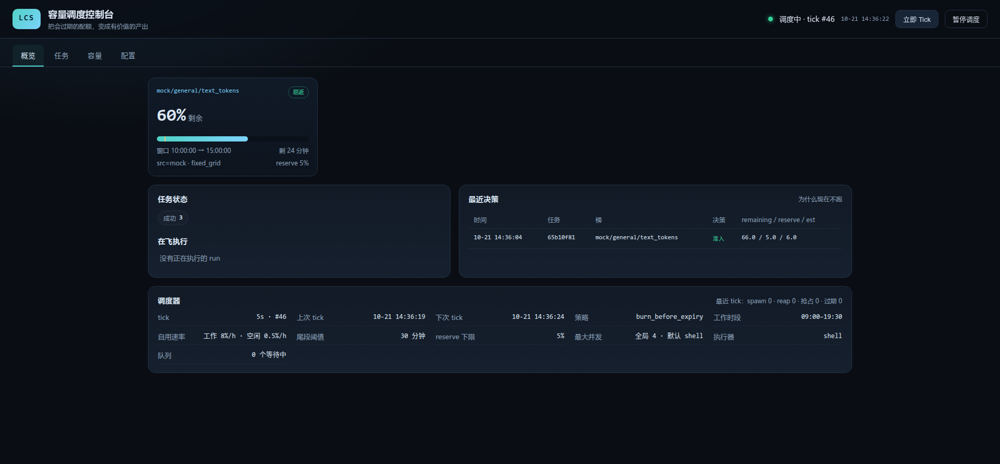

# llm-capacity-scheduler（LCS）

> **把会过期的 LLM 配额，变成有价值的产出。**
>
> LCS 是一个 **7×24 常驻的异步任务调度服务**：它持续观测各 LLM 供应商的容量窗口
> （配额百分比 / 余额 / 限流），按「价值 × 紧急度 × 窗口余量」决定**什么时候、用谁、用多强**
> 去跑你提交的任务。执行器是 **dsh headless**（v0.3 起唯一执行器），任务串行执行。
>
> 调用方（agent / 脚本 / 人）只做三件事：**提交 → 轮询 → 取产物**，不需要关心调度细节。

```
┌─────────────┐   submit / poll    ┌──────────────────────────┐   spawn   ┌──────────────┐
│  客户端      │ ─────────────────▶ │ LCS 常驻服务（唯一写状态）│ ────────▶ │ dsh headless │
│ MCP / 插件   │ ◀───────────────── │ 观测容量 → 准入 → 排队   │ ◀──────── │ 独立 DSH_HOME│
│ HTTP / CLI   │   state + artifacts│ Web 控制台 :7788         │  NDJSON   │ 每任务一会话 │
└─────────────┘                    └──────────────────────────┘           └──────────────┘
```



---

# 给 agent 的阅读顺序

你是被叫来「用 LCS 干活」的 agent。**不要通读全文**，按下表跳到你要的那一节：

| 你现在的处境 | 读哪几节 |
|---|---|
| 第一次接触，要判断该不该用 | **§0**（30 秒判断）→ **§1**（确认接入方式）→ **§1.1**（工具不在时怎么接） |
| 已经决定要用，要跑通一个任务 | **§2**（最小闭环）→ **§5**（轮询节奏） |
| 任务卡住 / 一直不跑 / 失败了 | **§6**（为什么不跑）→ **§8**（失败处理）→ **§11**（排障） |
| 要写代码或脚本接入 | **§3**（工具契约）→ **附录 A**（HTTP API） |
| 要动配置 / 清理 / 删除类操作 | **§10**（安全红线）**必读** |

**三条最重要的规则**（其他都可以后补）：

1. **`state=deferred` 是正常状态，不是失败** —— 不要因为它 deferred 就重复提交或放弃。
2. **轮询按 §5 的节奏来** —— 不要 `while(1)` 每秒查一次。
3. **报告结果必须带证据** —— `task_id`、`state`、产物路径、真实用量；只说「跑完了」不合格。

---

## §0 30 秒判断：这个任务该不该丢给 LCS

LCS 的价值是「**用本来会浪费的配额，换不着急的产出**」。所以只判断两件事：**急不急**、**烧不烧 token**。

| 任务特征 | 结论 |
|---|---|
| 需要在 1 分钟内拿到结果 | ❌ 不要用 LCS，自己直接做 |
| 需要多轮交互、要人盯着看 | ❌ 不要用 LCS |
| 只是查/改一个文件、跑一条命令 | ❌ 不要用 LCS（开销比收益大） |
| 要烧几万～几十万 token，或跑十几分钟以上 | ✅ 适合 |
| 用户明确说「不急」「后台跑」「配额快过期了」「用剩下的额度」 | ✅ 适合 |
| 批量活儿（整理文档、批量总结、批量生成、代码巡检） | ✅ 最适合 |
| 有明确 deadline（今天/本周内） | ✅ 适合（提交时给 `deadline`） |

**判断口诀**：`不急 + 要烧不少 token + 用户可以等` → 用 LCS；其它情况自己做。

> 如果用户只想看「配额还剩多少 / 为什么我的任务还没跑」→ 直接 `lcs_status`，不用提交任务。

---

## §1 确认你的接入方式

LCS 有三种入口，**能力完全等价**。按你手上有什么选：

| 你拥有的 | 用什么 | 怎么确认 |
|---|---|---|
| 会话工具里有 `lcs_submit_task` 等 7 个工具 | **原生工具**（dsh 插件 / MCP 客户端） | 看工具列表，或试调 `lcs_status` |
| shell + 网络 | **HTTP API**（`curl`） | `curl -s http://127.0.0.1:7788/api/health` |
| shell + npm 全局包 | **CLI**（`lcs-mcp`） | `lcs-mcp --version` |

**先跑这条探测命令**（一次搞清楚环境）：

```bash
curl -s --max-time 3 http://127.0.0.1:7788/api/health \
  && echo "→ 服务活着，可以用 HTTP 或原生工具" \
  || echo "→ 服务没起：lcs-mcp status / lcs-mcp start"
```

### 服务没起怎么办

| 情况 | 动作 |
|---|---|
| 装了但没启动 | `lcs-mcp start`（后台常驻；`lcs-mcp status` 看是否成功） |
| 重启机器就没了 | 托管成 systemd 用户级服务，见 §1.2（开机自启、7×24） |
| 没装 | `npm install -g llm-capacity-scheduler-mcp`，然后 `lcs-mcp init && lcs-mcp start` |
| 启动了但 `doctor` 有 ✗ | 见 §11；**不要**自己改 `~/.lcs/dsh-home` 或 `~/.dsh` |
| 没有权限装包 | 停下来，把 §12 的交接模板给人 |

> ⚠️ **不要为了跑一个任务就去改 `engine.dshHome`、删会话目录、动 `~/.dsh`** —— 见 §10。

### 1.1 如果工具不在、需要自己接上（装客户端）

三种接法，任选：

```bash
# ① dsh 用户（推荐）：a 装包 → b 注册 bundle → c 验证 → 重启 dsh
#    完成后 agent 会话里会原生多出 7 个 lcs_* 工具
dsh plugin --profile web add llm-capacity-scheduler-mcp     # a. 装依赖（就是 pnpm add 的透传）

# b. 注册 bundle —— ⚠️ 这一步 dsh plugin 不会替你做，漏了就是「装了但不加载」
node -e '
  const fs = require("fs"), f = process.env.HOME + "/.dsh/profiles/web/package.json";
  const p = JSON.parse(fs.readFileSync(f, "utf8"));
  const b = p.dsh.profile.bundles;
  if (!b.includes("llm-capacity-scheduler-mcp")) {
    b.push("llm-capacity-scheduler-mcp");
    fs.writeFileSync(f, JSON.stringify(p, null, 2) + "\n");
    console.log("已注册 bundle");
  } else console.log("bundle 已存在");
'

dsh --profile web --dump-config | grep -A2 lcs-client         # c. 能看到 - id: lcs-client 才算接上
# 然后重启 dsh（web/tui 都要重启进程才加载新插件）

# ② 任意 MCP 客户端：加一条 stdio server 配置
#    { "mcpServers": { "lcs": { "command": "lcs-mcp", "args": ["--config", "/home/you/.lcs/config.json"] } } }

# ③ 什么都不装：直接用 HTTP（见 §2 的 curl 版本）
```

> 如果还没发到 npm：GitHub Release 上的 `.tgz` 资产可以直接装（同一个包既是服务也是插件）：
> `npm install -g <asset>.tgz` / `dsh plugin --profile web add <asset-url>`，详见
> [`RELEASING.md`](RELEASING.md) §4。
>
> **装插件报 `ERR_PNPM_IGNORED_BUILDS`**：pnpm 11 要求对 profile 里**已有**插件的 postinstall
> 明确表态（不是我们包的错）。按提示把 `~/.dsh/profiles/<profile>/pnpm-workspace.yaml` 里
> `allowBuilds:` 下那条的占位值 `set this to true or false` 改成 `true`（或 `false`），再重跑 `dsh plugin`。
>
> 裸跑 `lcs-mcp`（不带子命令）= **MCP stdio + 调度器 + Web**，供客户端当子进程拉起。
> 如果已经有常驻服务在跑，它会自动降级成 **HTTP 代理**接入同一个实例，
> 不会出现两个进程抢写状态（这是设计，不是 bug）。
>
> `lcs-mcp serve` 是**前台**版常驻（不接 MCP），给 systemd / pm2 之类的托管用；
> 日常用 `lcs-mcp start`（后台）就够了。

### 1.2 常驻托管：开机自启、7×24

`lcs-mcp start` 是「手动后台」，机器一重启就没了。要 7×24 就用 systemd **用户级**服务
（不需要 root；`linger` 打开后开机即起、不要求有人登录）：

```bash
bash scripts/install-service.sh --dry-run   # 先看要写入的 unit，不动手
bash scripts/install-service.sh             # 安装/更新并启动（幂等，可反复跑）
bash scripts/install-service.sh --check     # 看 enabled / active / linger / main pid
bash scripts/install-service.sh --uninstall # 停用并删除 unit
```

脚本会自动探测 `node` / `lcs-mcp` / 配置路径并写 `~/.config/systemd/user/lcs-mcp.service`：

- `Restart=always` + `StartLimitIntervalSec=0` → 崩溃无限拉回（不会被 systemd 打成 failed 终态）
- `KillMode=control-group` → 停服务时连正在跑的 dsh 执行器一起收，不留孤儿
- `PATH` 里带上 `dsh` 所在目录（执行器靠 `dsh` 命令名解析）；`TZ` 决定 policy 的工作时段窗口

> ⚠️ **服务由 systemd 托管后，不要再用 `lcs-mcp stop` 停它** —— 会被 `Restart=always`
> 立刻拉回。用 `systemctl --user stop lcs-mcp.service`。
> 日志：`tail -f ~/.lcs/logs/lcs.log`（引擎自己的），或
> `journalctl _PID=$(systemctl --user show -p MainPID --value lcs-mcp.service) -f`。

**升级版本**：把新包装到 `lcs-mcp` 原地（`npm i -g llm-capacity-scheduler-mcp@x.y.z`，
或 prefix 安装覆盖同一路径），然后 `systemctl --user restart lcs-mcp.service`；
unit 内容没变就不必重跑脚本（跑也无害，脚本是幂等的）。


---

## §2 最小闭环（复制即用）

一个完整任务 = **提交 → 轮询 → 取产物 → 汇报**。

### 2.1 先看有没有容量（可选但推荐，3 秒）

**原生工具**：`lcs_status`

**HTTP**：
```bash
curl -s http://127.0.0.1:7788/api/status \
  | jq '{taskCounts, buckets: [.buckets[] | {shortKey, remaining, reservePct, minutesToEnd}]}'
```

读法：`remaining - reservePct` 就是**此刻可以自由支配的余量**。≤ 0 说明现在肯定不跑，
但**仍然应该提交**（提交完它自己会等；这就是 LCS 的用法）。

### 2.2 提交

**原生工具**：

```jsonc
lcs_submit_task({
  "prompt": "总结 docs/ 下所有设计文档，输出 800 字摘要写到 summary.md",
  "tokens": 120000,                    // 预估消耗（决定能不能排上）
  "value": 60,                         // 0-100，越大越优先
  "expect_artifacts": ["summary.md"],  // 声明产物 → 缺了就算失败
  "deadline": "2026-10-25T18:00:00",   // 可选：过期作废
  "task_class": "doc-summary",         // 可选：同类任务共享消耗校准
  "idempotency_key": "docs-summary-20261023"  // 可选但强烈建议
})
```

**HTTP**：
```bash
curl -s -X POST http://127.0.0.1:7788/api/tasks \
  -H 'content-type: application/json' \
  -d '{"prompt":"总结 docs/ 下所有设计文档…","tokens":120000,"value":60,
       "expect_artifacts":["summary.md"],"idempotency_key":"docs-summary-20261023"}'
# → {"task_id":"task_xxx","state":"submitted","created":true,...}
```

**拿到 `task_id` 后立刻记下来**（后面全靠它）。`created:false` 表示幂等键命中——
这个活儿已经提交过了，**不要换个 key 再提一遍**。

### 2.3 轮询（**必须按 §5 的节奏**）

**原生工具**：`lcs_poll_tasks({"ids": ["task_xxx"]})`

**HTTP**：
```bash
curl -s 'http://127.0.0.1:7788/api/tasks/task_xxx' \
  | jq '{state, error, runs: [.runs[] | {status, verified, artifacts, error}]}'
```

看到 `state` 是下面四个之一就**停止轮询**：`succeeded` / `failed` / `cancelled` / `expired`。
`deferred` / `queued` / `submitted` → 按 §5 继续等；`running` → 快了。

### 2.4 取产物

产物在 `run.artifacts`（相对路径数组），物理位置：

```
<engine.artifactsDir>/<task_id>/<run_id>/<artifact>     默认 = ~/.lcs/artifacts/…
```

- **dsh 任务的默认产物是 `final.md`**：dsh 把最终答案打在 stdout，LCS 自动落成 `final.md`。
- 你在 prompt 里让它写文件（如 `summary.md`），只要文件出现在工作目录、且写进了
  `expect_artifacts`，LCS 就会把它拷进产物目录。

三种取法，按环境选：

```bash
# ① 有 shell：直接读（runDir 从 HTTP 拿）
RUN_DIR=$(curl -s http://127.0.0.1:7788/api/tasks/task_xxx | jq -r '.runs[-1].runDir')
cat "$RUN_DIR/final.md"

# ② HTTP 下载单个产物
curl -s -OJ "http://127.0.0.1:7788/api/tasks/task_xxx/artifact?run=<run_id>&name=final.md"

# ③ 原生工具：只能看到文件名，读内容仍需 ①/②
```

### 2.5 汇报（照这个模板，别漏证据）

```
✅ 任务完成：<一句话结果>
- task_id: task_xxx          （重跑/追问都靠它）
- 耗时：14 分钟（19:03 → 19:17；其中执行 2 分 30 秒，其余在等窗口）
- 用量：in 98k / out 12k tokens（真实计量，来自 dsh）
- 产物：~/.lcs/artifacts/task_xxx/run_xxx/final.md + summary.md
- 当时桶：minimax/general/pct remaining 42%
```

失败时把 §8 的结论一起给人（原因 + 你做了什么 + 建议），不要只说「失败了」。

---

## §3 工具契约（唯一真源：`mcp/src/tool-specs.ts`）

7 个工具。**参数名是 snake_case**（`task_id` / `idempotency_key`），别写成 camelCase。

| 工具 | 作用 | 参数 |
|---|---|---|
| `lcs_submit_task` | 提交任务（不立即执行） | 见 3.1 |
| `lcs_poll_tasks` | 查状态 / 结果 / 产物 | `ids[]`、`states[]`、`limit`(1..200) |
| `lcs_cancel_task` | 取消**未开始**的任务 | `task_id`（必填） |
| `lcs_status` | 容量桶 + 队列 + 在飞 + 最近决策 | 无 |
| `lcs_observe` | 立即观测一次容量（不耗配额） | 无 |
| `lcs_tick` | 手动跑一轮调度（调试用） | 无 |
| `lcs_get_config` | 读配置（Key 已脱敏为 `***`） | 无 |

### 3.1 `lcs_submit_task` 参数（按「影响什么」分组）

**① 跑什么（`prompt` 与 `cmd` 二选一，必填一个）**

| 参数 | 说明 |
|---|---|
| `prompt` | 给 dsh 的任务文本（**LLM 任务用这个**） |
| `cmd` | 字符串数组。dsh 会把它 join 成任务文本；**不是**直接执行的 shell 命令 |
| `cwd` | 覆盖执行目录（默认每个 task 一个固定工作目录） |
| `env` | 额外环境变量（`{K:V}`） |
| `timeout_s` | 单次执行超时秒数 |

**② 产出什么（决定成功判定）**

| 参数 | 说明 |
|---|---|
| `expect_artifacts` | 声明产物（相对工作目录的路径）。**缺一个 = 失败**（`缺少声明产物`） |
| `verify_cmd` | 验收命令数组，**exit 0 才算成功**，在工作目录执行 |

> 「成功」= `exit 0` **且** 产物齐全 **且** `verify_cmd` 通过。
> 两者都不写时，dsh 正常退出即成功（产物通常只有 `final.md`）。

**③ 什么时候跑（**最影响成败的一组**）**

| 参数 | 默认 | 说明 |
|---|---|---|
| `value` | `50` | 业务价值 0..100，越大越优先。付费桶要求 `value ≥ 成本 × 100` |
| `tokens` | — | 预估 text token 消耗。**给大了可能永远排不上，给小了会烧超** |
| `est_pct` | — | 预估消耗（百分点），与 `tokens` 二选一 |
| `est_cost` | — | 付费型 provider 的预估成本（余额型桶必需，否则 `no_cost_estimate`） |
| `deadline` | — | ISO 时间；过了就 `expired`，不再执行 |
| `expected_duration_s` | `300` | 预估时长。**窗口剩余时间装不下就不开跑**（`window_too_short`） |
| `providers` | 不限 | 限定 provider 名（可多个） |
| `model_family` | 不限 | 限定模型族，如 `general` |
| `quality_tier` | 不限 | `cheap` / `standard` / `best` |
| `min_context` | 不限 | 最小上下文窗口 |
| `modalities` | `text` | 需要的模态 |

> **估算建议**：不确定就不传 `tokens`（引擎用 `defaultEstPct=3%` 保守估）。
> 知道量级就传（一次 10 万 token → `tokens: 100000`）。
> 别为了「更容易排上」把 `tokens` 压得很小——实际消耗会超估，校准会失真。

**④ 运维**

| 参数 | 说明 |
|---|---|
| `idempotency_key` | 幂等键。同 key 重复提交返回 `created:false`，不会重复执行。**建议永远给** |
| `task_class` | 任务类，同类任务共享消耗校准（如 `doc-summary`、`code-review`） |

### 3.2 `lcs_poll_tasks` 返回（数组，每个元素）

```jsonc
{
  "task_id": "task_xxx",
  "state": "succeeded",          // 见 §4
  "task_class": "default",
  "value": 60,
  "attempts": 1,                 // 已尝试次数；>1 说明重试过
  "deadline_ms": 1792726400000,  // 或 null
  "has_checkpoint": true,        // true = 重试复用同一个 dsh 会话（上下文不丢）
  "error": null,                 // 失败原因（人话 / 机器码）
  "runs": [
    {
      "run_id": "run_xxx",
      "status": "succeeded",     // succeeded / failed / interrupted / running / timeout
      "provider": "minimax",
      "model": "MiniMax-M3.1-Flash[1m]",
      "runner": "dsh",
      "started_at": 1792725...,
      "ended_at": 1792726...,
      "exit_code": 0,
      "verified": true,          // 关键：false = 跑了但没通过验收（会重试）
      "artifacts": ["final.md", "summary.md"],
      "quota_delta": 24,         // 实际消耗（百分点）；并发时可能为 null（无法归因）
      "error": null
    }
  ]
}
```

> **`status=succeeded` 但 `verified=false`** → 引擎会重试；最多 `maxAttempts=2` 次后任务才 `failed`。

### 3.3 `lcs_status` 怎么读

```jsonc
{
  "scheduler": {"started": true, "paused": false, "tickSeconds": 60, "tickCount": 2442},
  "policy": {"maxAttempts": 2, "maxParallel": 1, "minReservePct": 5},
  "buckets": [{
    "key": "minimax/general/pct/fixed_grid:...",
    "shortKey": "minimax/general/pct",
    "remaining": 42,            // 百分比 / 计数 / 金额，看 unit
    "reservePct": 18,           // 从现在到窗口结束「必须留给自己」的量
    "minutesToEnd": 96,
    "lifecycle": "fixed_grid",  // fixed_grid / rolling_on_first_use / calendar / depleting / unlimited
    "unlimited": false,
    "perishable": true,         // true = 会过期，值得烧
    "paid": false
  }],
  "taskCounts": {"deferred": 2, "running": 1, "succeeded": 40},
  "queue": [{"id": "task_x", "state": "deferred", "score": 71.2}],
  "running": [{"id": "run_x", "taskId": "task_y", "startedAt": 1792...}],
  "recentDecisions": [{"taskId": "task_x", "reason": "reserve", "admit": false,
                       "est": 4.5, "reserve": 18, "excess": -2.1, "slots": 2}],
  "gc": {"dshHome": "/home/…/.lcs/dsh-home", "refused": null}
}
```

**三条读法**：

1. `remaining - reservePct ≤ 0` → 现在不会烧，别催；这是设计。
2. `recentDecisions[].reason` 就是「为什么没跑」的逐字答案（见 §6）。
3. `gc.refused` 非空 = **清理被安全校验拦住了**（配置有问题）→ 立刻告诉人，别自己改。

### 3.4 其它

- `lcs_cancel_task`：**只能取消 `submitted/queued/deferred/admitted`**。`running` 的取消不了
  （返回 `cancelled:false`），只能等它跑完。
- `lcs_tick`：手动推一轮调度。**日常不要用**（引擎每 60s 自己跑）；只在「用户说提交了没反应」
  且确认服务活着时用一次，然后把 `decisions` 的原因告诉人。
- `lcs_get_config`：Key 是 `***`。**不要试图从任何地方读出 Key 明文**。

---

## §4 状态机：看到什么状态做什么

```
submitted ──▶ queued ──▶ deferred ──▶ admitted ──▶ running ──┬─▶ succeeded（终态）
    │           ▲            │            │                   ├─▶ queued（重试/被抢占）
    │           └────────────┴────────────┘                   └─▶ failed（终态，重试用尽）
    └────────────▶ cancelled（人工取消，终态）
                   expired（超 deadline，终态）
```

| state | 含义 | 你该做什么 |
|---|---|---|
| `submitted` | 刚入库，下个 tick（≤60s）就会评估 | 等 15~30s 再查 |
| `queued` | 等重试退避（`nextEligibleAtMs`）或刚被窗口抢占重排 | 等；**不要**重新提交 |
| `deferred` | **容量不满足，正在等时机**（正常状态，可能几小时～几天） | 按 §5 拉长间隔继续等；必要时看 §6 |
| `admitted` | 已分配，正在拉起 dsh 子进程（秒级） | 等 30~60s |
| `running` | dsh 正在执行 | 60s 查一次 |
| `succeeded` | **通过验收**（exit 0 + 产物齐 + verify_cmd 过） | 取产物 + 汇报，**停止轮询** |
| `failed` | 重试用尽 | 按 §8 决策树 |
| `cancelled` | 被取消 | 停止；问用户要不要重新提 |
| `expired` | 超过 `deadline` 未执行 | 停止；问用户是否延期重提（换 idempotency_key） |

**高频错误（别犯）**：

- ❌ 把 `deferred` 当失败然后重新提交 → 队列里堆重复任务
- ❌ `queued` 时用 `lcs_tick` 猛催 → 没用（引擎本来就在跑）
- ❌ `running` 时每秒 poll → 浪费时间和 token
- ❌ 看到 `failed` 就原样重提 → 先看 `error`（认证/配额类错误重提一定再失败，见 §8）

---

## §5 轮询策略（硬规则，照做）

> 调度 tick 默认 **60 秒**，比 60s 更频繁的轮询没有任何信息增量。

| 阶段 | 间隔 |
|---|---|
| 提交后第一次查询 | 15~30 秒 |
| `submitted` / `queued` / `deferred` | 60s → 2min → 5min → **15min 封顶**（指数退避） |
| `running` | 60 秒 |
| 到达终态 | **停止** |
| 有 `deadline` | deadline 前 1 小时再确认一次 |

**额外规则**：

- **一次查多个**：`lcs_poll_tasks({"ids": [...]})` 批量查，不要一个个查。
- **不要 `while(true) sleep(1)` 死等**：单次会话里最多盯 10~15 分钟；更长的任务请
  「记下 task_id，稍后回来查」或交给定时任务/人。
- **超过 1 小时还在 `deferred` 是正常的**（配额窗口可能 5 小时 / 1 周才刷新一次）。
  正确做法：告诉人「已排队，预计在 X 窗口内跑」，并把 `task_id` 留下。
- 服务重启不影响已提交任务（状态在 `~/.lcs/state.json`），继续用原 `task_id` 查。

---

## §6 为什么现在不跑（`reason` 速查）

`recentDecisions[].reason`（或 `lcs_tick` 返回的 `decisions[].reason`）逐字对应下表：

| reason | 含义 | 你能做什么 |
|---|---|---|
| `admit` | ✅ 本轮通过 | 不用做什么，马上就会跑 |
| `no_bucket` | 没有满足要求的桶（provider/family/context/模态限制太严） | 放宽 `providers` / `model_family`；或找人在 Web 加厂商 |
| `unknown` | 该桶还没观测到容量（刚启动/刚加 Key） | 调一次 `lcs_observe`，等 1 个 tick |
| `unlimited` | 该桶是「无限额」型，不参与燃烧调度 | 不用等，这个桶不会跑任务 |
| `not_schedulable` | 该桶不可调度（如非可燃烧的余额型） | 换 provider，或找人类确认策略 |
| `no_window_end` | 该桶没有窗口结束时间（滚动型），算不出「该烧多少」 | 等下一个窗口，或换 provider |
| `work_hours_wait` | 策略规定工作日中段不烧（保护配额） | **等**；`policy.workHoursOpportunistic=true` 可放宽 |
| `window_too_short` | 窗口剩余时间装不下这个任务（`expected_duration_s` 太大） | 减小 `expected_duration_s`，或等下一个窗口 |
| `self_busy` | 同一账号上观测到**外部**在消耗 | **等**。保护机制：不跟外部/用户自己的会话抢配额 |
| `reserve` | 余量 - 预留 - 已承诺 < 本次预估 | 等窗口刷新；或降低预估（别造假）；或提高 `value` |
| `balance` | 余额不足 | 找人类充值 / 换 provider |
| `no_cost_estimate` | 付费桶缺成本估计 | 提交时给 `est_cost` |
| `not_worth_cost` | 任务价值低于成本（`value < 成本×100`） | 提高 `value`（如果确实值这个价） |
| `slots` | 并发槽位满了（全局串行 `maxParallel=1`） | 等前面的任务跑完 |
| `value` | `value` 非法（<0） | 修正参数 |

> 判断口诀：**`reserve` / `slots` / `self_busy` / `work_hours_wait` / `balance` = 等；
> `no_bucket` / `value` / `est_cost` / `window_too_short` = 改参数；`unknown` = 等观测。**

---

## §7 结果与产物（路径与边界）

| 东西 | 位置 | 说明 |
|---|---|---|
| 任务状态库 | `~/.lcs/state.json`（0600） | 唯一真相源；服务重启不丢 |
| 产物 | `~/.lcs/artifacts/<task_id>/<run_id>/` | `final.md` 是 dsh 的最终答案 |
| 执行工作目录 | `~/.lcs/work/<task_id>/` | 每 task 固定；重试复用同一目录 |
| dsh 会话 | `~/.lcs/dsh-home/sessions/…` | **LCS 专用隔离家目录**，与用户 `~/.dsh` 物理隔离 |
| 后台日志 | `~/.lcs/logs/lcs.log` | `lcs-mcp logs -f` |
| Web 控制台 | `http://127.0.0.1:7788` | 任务详情页可看执行日志（dsh NDJSON 尾部） |

**产物规则（重要）**：

1. 产物**只**在 `runDir` 里被认（`expect_artifacts` 会去工作目录找并拷进来）。
2. dsh 任务不写文件也没关系 → 最终答案自动落 `final.md`。
3. `expect_artifacts` 写了但文件不存在 → `缺少声明产物: xxx` → 任务失败（会重试）。
4. 产物按 `engine.sessionRetentionDays`（默认 7 天）保留，**过期会被 GC 删掉** →
   重要产出请在完成后**自己转存**到别处。

---

## §8 失败处理决策树

```
state == failed
├─ error 含 auth / 401 / 403 / invalid key
│    → ❌ 不要重试。Key 无效或权限不足 → 交给人类（§12）
├─ error 含 quota / 429 / rate limit / 余额
│    → ❌ 不要立刻重试。找人类确认额度；或降低预估后再提
├─ error 含 timeout
│    → ✅ 加大 timeout_s / 减小任务粒度，换 idempotency_key 重提
├─ error 含 缺少声明产物 / verifier 失败
│    → ✅ 先读 runDir + GET /api/runs/<run_id>/log 定位；
│       要么改 prompt 让它真的产出，要么修正 expect_artifacts 后重提
├─ error 含 interrupted / 窗口抢占
│    → 不用管：引擎会自己 requeue 并用同一 session 续跑
└─ 其它 / 你不知道
     → 读 GET /api/runs/<run_id>/log?tail=20000（dsh 原始事件流），
       把日志尾部贴给人，不要瞎猜
```

**重试规则**：引擎自己最多试 `policy.maxAttempts=2` 次（每次复用同一 dsh 会话，
`has_checkpoint=true` 说明上下文还在）。**你重新提交 = 新一轮，会重新烧配额**，
所以先看 `error` 再决定。

**查看执行日志**：
```bash
RUN_ID=$(curl -s http://127.0.0.1:7788/api/tasks/task_xxx | jq -r '.runs[-1].id')
curl -s "http://127.0.0.1:7788/api/runs/$RUN_ID/log?tail=20000" | jq -r '.text'
```

---

## §9 幂等：不要重复提交

- **永远给 `idempotency_key`**，用业务语义而不是随机数，例如
  `doc-summary-20261023`、`review-pr-482-20261023`。
- `created:false` = 已提交过 → **直接用返回的 `task_id` 去轮询**，不要换 key 重提。
- 重试同一个活儿（上次失败要改参数重跑）→ **换一个新 key**（如加 `-retry2`），
  否则会被幂等拦下、返回旧任务。
- `task_id` 跨会话有效：服务重启、agent 重启都不影响，记下来就能接着查。

---

## §10 安全红线（**绝对不做**，除非人类明确要求并确认）

> 背景：2026-10-22 曾发生真实数据丢失事故——LCS 早期版本与用户共享 `~/.dsh` 时，
> 清理逻辑把用户 60+ 个主会话当孤儿删了。现在隔离是硬约束，不要绕过。

| 红线 | 为什么 |
|---|---|
| ⛔ **不要读写/删除 `~/.dsh/sessions/**`** | 用户主会话的唯一真相源，删了就没了 |
| ⛔ **不要把 `engine.dshHome` 改成 `~/.dsh` 或它的子目录** | 启动会被拒绝（这是保护）；绕过 = 重演事故 |
| ⛔ **不要 `rm -rf` 任何 LCS 目录以外的会话/产物** | 清理只走 `lcs-mcp gc` / `POST /api/gc` |
| ⛔ **不要把 API Key 写进 prompt / argv / 明文配置** | Key 只通过环境变量注入，配置里用 `apiKeyEnv` / `apiKeyFile` |
| ⛔ **不要用 `--force` 起第二个实例** | 两个进程写同一个 state 会损坏状态 |
| ⚠️ **GC / 删除 / 改配置前先 dry-run** | `lcs-mcp gc --dry-run`、`POST /api/gc {"dryRun":true}` |
| ⚠️ **产物会按保留期被清理** | 重要产出完成即转存 |

**清理只有三个合法入口**：`lcs-mcp gc`（含 `--dry-run`）、Web 概览页「清理预览」、
`POST /api/gc`。它们都只删「LCS 自己登记过、已终态、超保留期」的会话，未知会话只统计不删；
家目录不安全时会**整轮拒跑**，原因放在 `gc.refused`。

---

## §11 排障（症状 → 命令 → 处理）

| 症状 | 先查 | 处理 |
|---|---|---|
| `curl :7788` 连不上 | `lcs-mcp status` | `lcs-mcp start`；仍失败看 `lcs-mcp logs --tail 50` |
| 提交报错 / 工具不可用 | `lcs-mcp doctor` | 按 doctor 的 ✗ 逐项修；**不要自己猜** |
| 任务一直 `deferred` | `lcs_status` 的 `buckets` + `recentDecisions` | 按 §6 对号入座；告诉人「在等窗口」 |
| 任务一直 `queued` | `nextEligibleAtMs` | 等退避（60s 起）；反复失败看 §8 |
| `failed` | `task.error` + `/api/runs/<id>/log` | 按 §8 决策树 |
| `verified=false` 但 `exit_code=0` | 是否漏声明产物 / `verify_cmd` 不过 | 修 `expect_artifacts` 或 prompt |
| Web 能开但数据不更新 | `lcs_status.scheduler.started` | 调度器停了 → `POST /api/scheduler/resume` |
| `gc.refused` 非空 | `lcs-mcp doctor` 的「执行器家目录隔离」 | **立刻找人**，不要改配置硬闯 |
| 报 `已有实例在运行` | `lcs-mcp status` | 正常（单实例保护）；要重启用 `lcs-mcp restart` |

**三条排查命令**（够用 90% 场景）：

```bash
lcs-mcp doctor                       # 安装/配置/隔离/守护进程/插件接线
lcs-mcp logs --tail 80               # 服务日志
curl -s http://127.0.0.1:7788/api/status | jq '.taskCounts, .recentDecisions[0:5]'
```

---

## §12 交接模板（需要人类动手时，照这个说）

```
需要你操作（LCS）：
1. 现状：<doctor / logs 的关键输出，一两行>
2. 原因：<缺 Key / 服务没起 / 余额不足 / 配置被拒 …>
3. 请你执行：
   - [ ] lcs-mcp start
   - [ ] 打开 http://127.0.0.1:7788 → 配置 → Provider → 「添加 LLM」→ 选厂商 + 填 API Key → 保存
   - [ ] lcs-mcp doctor（期望全绿）
4. 做完告诉我，我继续提交任务（task_id 会保留）。
```

**绝不要**替人做这些：写入/修改 API Key、改 `engine.dshHome`、删会话、升级/降级包版本。

---

## §13 速查卡

```bash
# 服务
lcs-mcp start | stop | restart | status | logs -f | doctor | gc --dry-run
lcs-mcp --version                       # 打印当前版本（取自 package.json）

# 一个任务
curl -s -X POST localhost:7788/api/tasks -H 'content-type: application/json' \
  -d '{"prompt":"…","tokens":100000,"value":60,"expect_artifacts":["summary.md"],
       "idempotency_key":"<业务键>"}'
curl -s localhost:7788/api/tasks/<task_id>                  # 状态+runs+artifacts+runDir
curl -s 'localhost:7788/api/runs/<run_id>/log?tail=20000'   # dsh 原始日志
curl -s localhost:7788/api/status                           # 容量 + 决策原因

# 三条铁律
# 1) deferred 正常，别重提  2) 轮询 60s 起、15min 封顶  3) 汇报带 task_id + 产物路径 + 用量
```

---

## 附录 A：HTTP API 全表

| 方法 | 路径 | 用途 |
|---|---|---|
| GET | `/api/health` | 存活 + 版本 + pid + uptime |
| GET | `/api/status` | 容量桶 / 队列 / 在飞 / 决策 / gc |
| GET | `/api/config` | 配置（Key 脱敏 `***`） |
| PUT | `/api/config` | 保存配置（`***` = 保留旧 Key），热加载 |
| GET | `/api/providers/vendors` | 可选厂商 + 模型列表 |
| POST | `/api/providers` | 添加厂商 `{vendor, apiKey, model?, name?}` |
| DELETE | `/api/providers/:name` | 删除厂商 |
| GET | `/api/tasks?state=&limit=` | 任务列表（camelCase） |
| POST | `/api/tasks` | 提交任务（同 `lcs_submit_task` 参数） |
| GET | `/api/tasks/:id` | 任务详情 + runs + artifacts + `runDir` |
| POST | `/api/tasks/:id/cancel` | 取消未开始的任务 |
| GET | `/api/tasks/:id/artifact?run=&name=` | 下载产物 |
| GET | `/api/runs?limit=` | 最近执行记录 |
| GET | `/api/runs/:id/log?tail=` | 执行日志（dsh NDJSON 尾部，默认 20KB） |
| POST | `/api/tick` | 手动一轮调度（调试） |
| POST | `/api/observe` | 立即观测容量 |
| GET | `/api/samples?limit=` | 容量采样序列（画图用） |
| POST | `/api/gc` | 清理，`{dryRun:true}` 预览 |
| POST | `/api/scheduler/pause` · `/resume` | 暂停 / 恢复调度 |

> **字段大小写不一致是故意的**：MCP 工具返回 **snake_case**（`task_id` / `started_at`），
> HTTP API 返回 **camelCase**（`id` / `startedAt` / `runDir`）。写脚本时别混。

## 附录 B：关键配置（`~/.lcs/config.json`，0600）

| 字段 | 默认 | 含义 |
|---|---|---|
| `engine.tickSeconds` | `60` | 调度周期 |
| `engine.stateFile` | `~/.lcs/state.json` | 状态库（单实例锁 = `<stateFile>.lock`） |
| `engine.artifactsDir` | `~/.lcs/artifacts` | 产物根 |
| `engine.workDir` | `~/.lcs/work` | 每任务工作目录根 |
| `engine.dshHome` | `~/.lcs/dsh-home` | **执行器专用 DSH_HOME，禁止指向 `~/.dsh`** |
| `engine.maxParallel` | `1` | 全局串行 |
| `engine.sessionRetentionDays` | `7` | 会话/产物保留天数（0 = 永久） |
| `engine.web` | `127.0.0.1:7788` | Web 控制台 |
| `runners.dsh.command` | `dsh` | dsh 可执行文件 |
| `runners.dsh.profile` | `lcs` | LCS 专用 dsh profile（自举） |
| `runners.dsh.timeoutS` | `3600` | 单任务超时 |
| `policy.maxAttempts` | `2` | 重试上限 |
| `policy.workHoursOpportunistic` | `false` | `true` = 工作时段也允许烧 |
| `policy.activityDropThresholdPct` | `1` | 检测「外部在消耗」的阈值（`self_busy`） |

环境变量覆盖：`LCS_CONFIG` / `LCS_STATE` / `LCS_ARTIFACTS` / `LCS_PORT` /
`LCS_TICK_SECONDS` / `LCS_WEB_HOST` / `LCS_NO_WEB=1`。

## 附录 C：目录布局与隔离边界

```
~/.lcs/
├── config.json        配置（0600）
├── state.json         任务/运行/采样/审计（唯一真相源）
├── state.json.lock    单实例锁（含 pid 与运行时 Web 地址）
├── logs/lcs.log       后台日志
├── artifacts/<task>/<run>/   产物（final.md …）
├── work/<task>/       每任务固定工作目录
└── dsh-home/          执行器专用 DSH_HOME（会话 / profile / 投影缓存）
    ├── AGENTS.md -> ~/.dsh/AGENTS.md       （共享：全局指令）
    ├── skills/                              （若 ~/.dsh/skills 存在则符号链接）
    ├── profiles/lcs/                        （自举的路由声明）
    └── sessions/<cwd-slug>/<session-id>/    （只有 LCS 任务的会话）
```

**共享 vs 隔离**（agent 常问）：

| 资产 | 状态 |
|---|---|
| `~/.agents/skills`（用户技能） | ✅ 共享（`agentsHome` 不吃 `DSH_HOME`） |
| `~/.agents/experiences`（经验） | ✅ 共享（绝对路径可读写） |
| `~/.dsh/AGENTS.md`（全局指令） | ✅ 共享（符号链接进隔离家目录） |
| `~/.dsh/sessions`（用户主会话） | ❌ **隔离**，LCS 只写自己的 `dsh-home/sessions` |
| `~/.dsh/.credentials.yaml` | ❌ 不共享，Key 只按 provider 注入环境变量 |

---

## 从源码跑（开发者）

```bash
cd mcp
npm install && npm run build
npm test                       # 74 个用例
npm run dev -- serve           # tsx 直跑
node bin/lcs-mcp.js start      # 后台常驻

# 出包（本地与 CI 同一份流水线）：产物落在 dist-release/
bash scripts/release.sh --install --verify-plugin
```

发版走 tag：`git tag v0.4.1 && git push origin v0.4.1` 会触发
[`.github/workflows/release.yml`](.github/workflows/release.yml) → 跑测试 → 出包 → 验证
→ 建 GitHub Release。完整流程见 [`RELEASING.md`](RELEASING.md)。

设计文档：[`docs/DSH-EXECUTION-DESIGN.md`](docs/DSH-EXECUTION-DESIGN.md)（执行器 / session / GC）、
[`docs/DSH-PLUGIN-INTEGRATION.md`](docs/DSH-PLUGIN-INTEGRATION.md)（dsh 插件接线）、
[`docs/DESIGN.md`](docs/DESIGN.md)（调度模型）。

## 许可证

[MIT](mcp/LICENSE)
